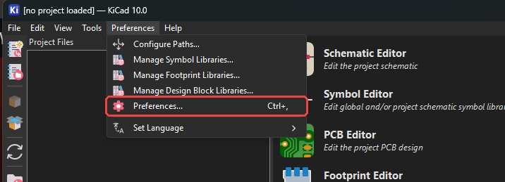
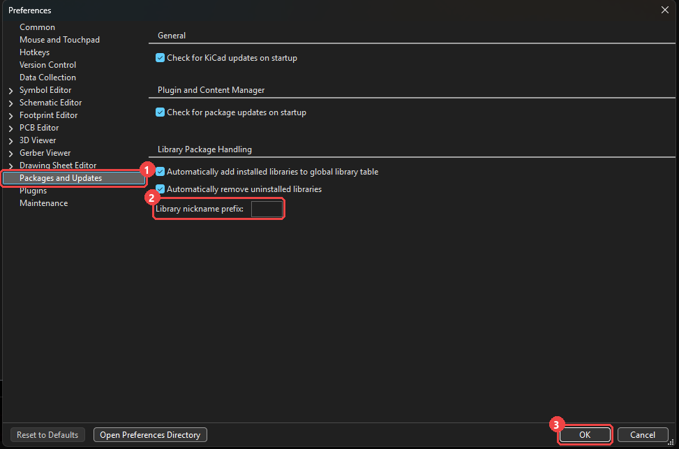
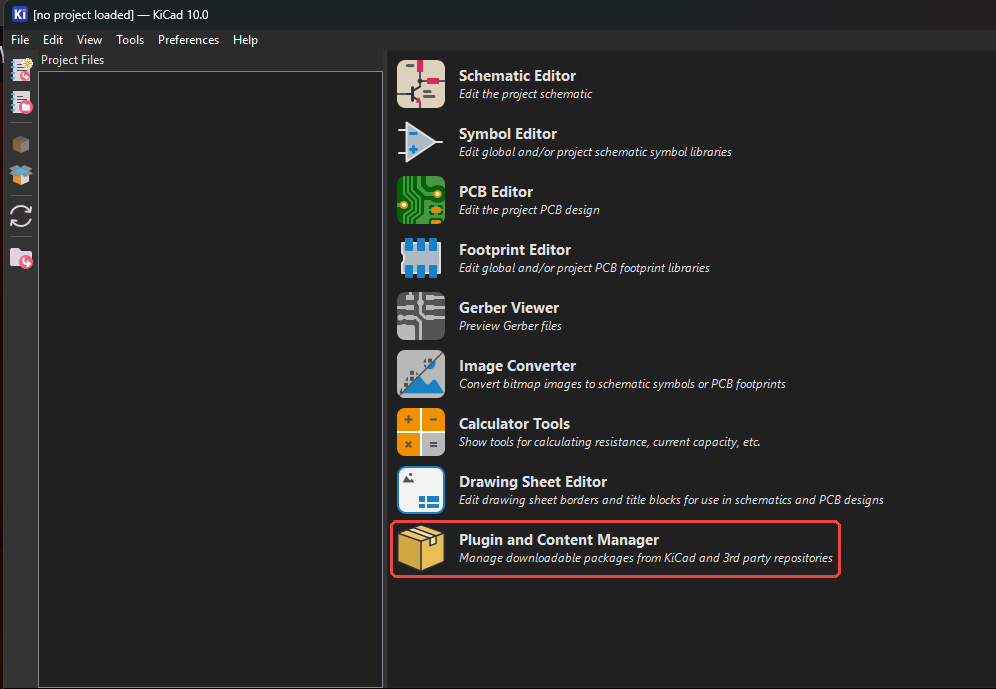
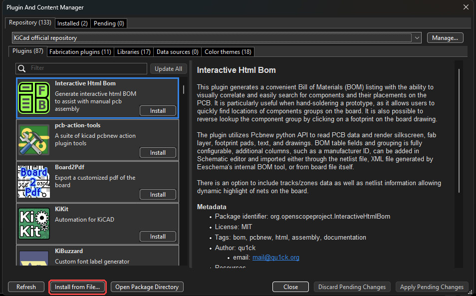
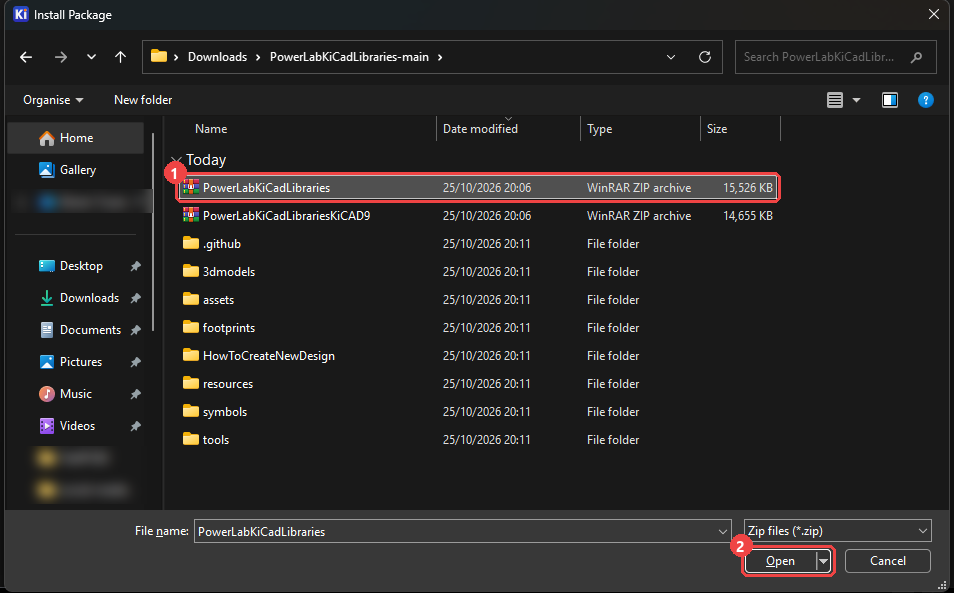
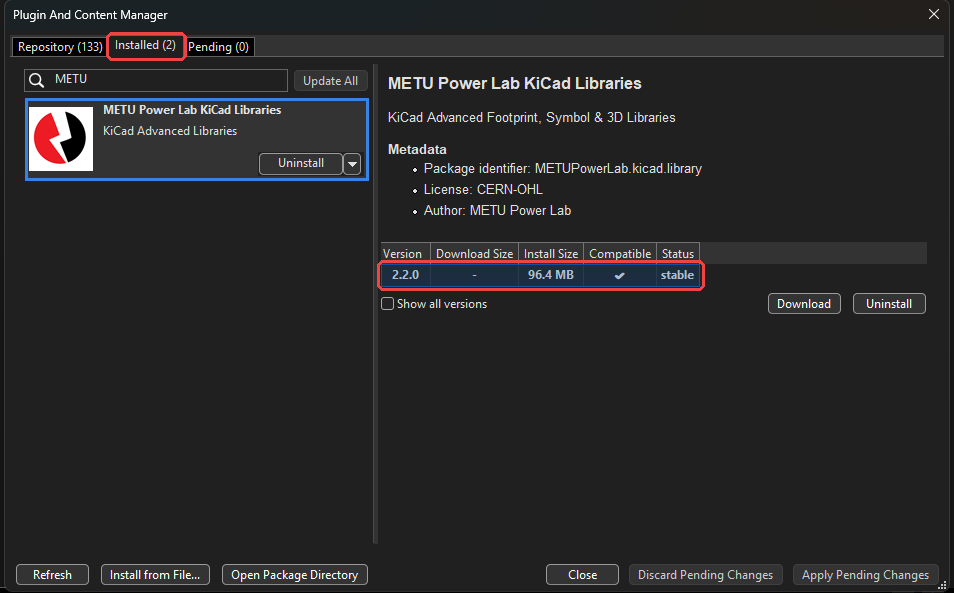
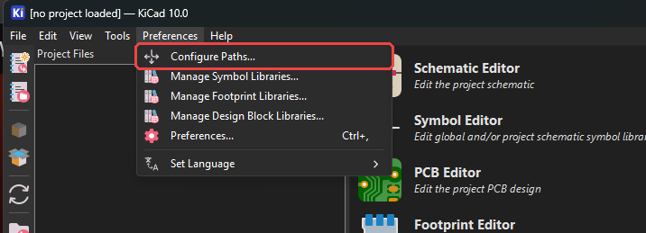
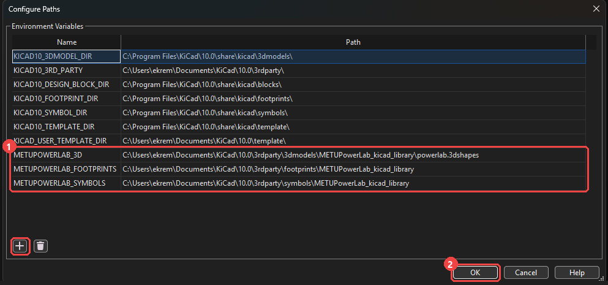
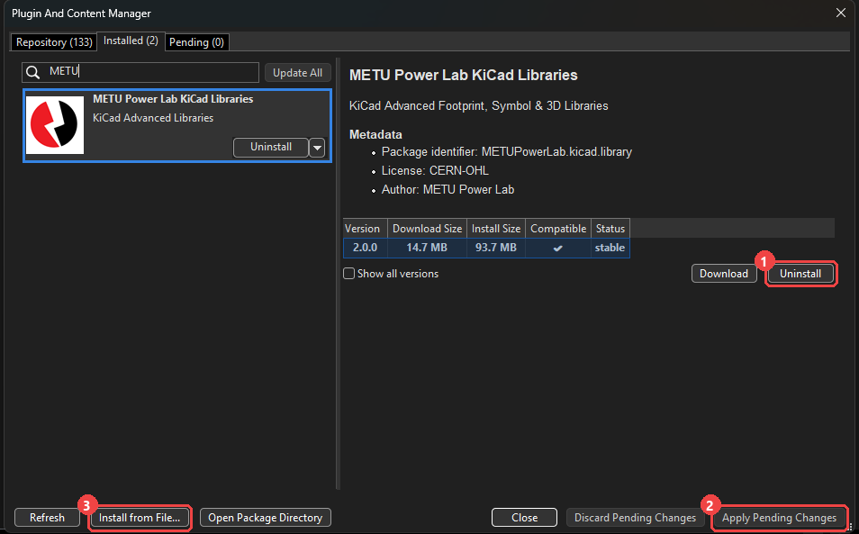

<div align="center">


# METU Power Lab KiCad Libraries

**Symbols, footprints and 3D models for power electronics design in KiCad.**

[](https://www.kicad.org/)
[](metadata.json)
[](https://github.com/odtu/PowerLabKiCadLibraries/actions/workflows/library-checks.yml)
[](license.txt)

[Install](#-installation) · [Update](#-updating) · [What's inside](#-whats-inside) · [Contribute](#-contributing)

</div>

---

## ✨ Highlights

- **48 symbol libraries** and **52 footprint libraries**, from passives and connectors to gate drivers, GaN power stages and C2000 microcontrollers.
- **3D STEP models** for the footprints, linked through a single `${METUPOWERLAB_3D}` path.
- **Ready to use parts**: datasheet, description, manufacturer and distributor numbers are filled in, and key ratings are shown on the symbol.
- **Checked on every change**: each pull request runs the lab's standards checker and is opened in KiCad 10 before it is merged.

> [!IMPORTANT]
> **KiCad 10.0 or newer is required** (since version 2.0.0). Some libraries are saved in the KiCad 10 file format and cannot be opened by KiCad 9.
> KiCad 9 users can keep using version 1.0.0: install [`PowerLabKiCadLibrariesKiCAD9.zip`](PowerLabKiCadLibrariesKiCAD9.zip) instead.

## 📦 Installation

The libraries are installed as a package with KiCad's **Plugin and Content Manager** (PCM).

### 1. Download

[**⬇ Download the repository as a ZIP**](https://github.com/odtu/PowerLabKiCadLibraries/archive/refs/heads/main.zip) and unzip it anywhere.
Inside you will find `PowerLabKiCadLibraries.zip`, the package you install in step 3. Do not unzip that one.

### 2. Clear the library nickname prefix

In the KiCad project manager, open **Preferences → Preferences… → Packages and Updates**, clear the **Library nickname prefix** box (leave it empty) and click **OK**.
This keeps the library names as `METUPowerLab_…`, the names the symbols use to find their footprints.

<details>
<summary>Screenshots</summary>




</details>

### 3. Install the package

1. Open **Plugin and Content Manager** from the KiCad project manager.
2. Click **Install from File…**.
3. Select **`PowerLabKiCadLibraries.zip`** from the folder you unzipped in step 1 and click **Open**.
4. Wait until **METU Power Lab KiCad Libraries** appears in the **Installed** tab, then close the window.

<details>
<summary>Screenshots</summary>






</details>

### 4. Set the path variables

Open **Preferences → Configure Paths…**, click **+** for each row below, and set the path to the matching folder of the installed package:

| Name | Path |
| --- | --- |
| `METUPOWERLAB_3D` | `<3rdparty>\3dmodels\METUPowerLab_kicad_library\powerlab.3dshapes` |
| `METUPOWERLAB_FOOTPRINTS` | `<3rdparty>\footprints\METUPowerLab_kicad_library` |
| `METUPOWERLAB_SYMBOLS` | `<3rdparty>\symbols\METUPowerLab_kicad_library` |

`<3rdparty>` is the folder shown as `KICAD10_3RD_PARTY` in the same dialog, usually `C:\Users\<you>\Documents\KiCad\10.0\3rdparty` on Windows.
Click into a **Path** box and use the folder button to browse to it, then click **OK**.

> [!TIP]
> `METUPOWERLAB_3D` is the one the footprints use for their 3D models. If parts show up without a 3D body in the 3D viewer, check this path first.

<details>
<summary>Screenshots</summary>




</details>

That's it. The `METUPowerLab_…` libraries are now listed in the symbol and footprint choosers. 🎉

## 🔄 Updating

The libraries change often, and KiCad does not update a package installed from a file by itself. To move to a new version:

1. Download the latest repository ZIP again ([step 1](#1-download)).
2. In **Plugin and Content Manager → Installed**, select **METU Power Lab KiCad Libraries**, click **Uninstall**, then **Apply Pending Changes**.
3. Click **Install from File…** and pick the new `PowerLabKiCadLibraries.zip`, as in [step 3](#3-install-the-package).

The path variables stay as they are, so there is nothing else to set.



## 📚 What's inside

| Category | Libraries |
| --- | --- |
| Amplifiers | Current sense, op-amps |
| Capacitors | Ceramic SMD, aluminum polymer THT |
| Circuit protection | eFuses, ferrite beads, ideal diodes, PTC fuses, TVS diodes |
| Connectors | Headers, power, screw terminals, signal, USB Type-C |
| Discretes | Schottky diodes, MOSFETs, GaN FET power stages, power blocks |
| Power | Buck converters, LDOs, linear and switching regulators, PWM controllers, voltage references |
| Drivers | Low-side gate drivers, BLDC motor drivers |
| Microcontrollers | TI C2000, TI MSPM0, ESP32 |
| Interfaces | CAN bus bridges, USB bridges, USB PD, USB isolators, EEPROM |
| Logic | AND / OR gates, comparators, counters, timers |
| Passives & misc. | Chip and shunt resistors, SMD inductors, crystals, LEDs, tactile switches, net ties, test points |
| Sensors | Encoders, temperature |
| Board (footprints only) | Fiducials, mounting holes, graphics |

Browse [`symbols/`](symbols), [`footprints/`](footprints) and [`3dmodels/`](3dmodels) for the full list.

## 🤝 Contributing

New parts are welcome. Start with the guides in [`HowToCreateNewDesign/`](HowToCreateNewDesign):

- [**DesignRules.md**](HowToCreateNewDesign/DesignRules.md): naming, fields, pin grid, 3D models and footprint rules.
- [**README.md**](HowToCreateNewDesign/README.md): how pull requests are checked and merged.

Run the standards checker before you open a pull request (Python 3, nothing to install):

```bash
python tools/check_library.py symbols/METUPowerLab_Xxxxx_Yyyy.kicad_sym footprints/METUPowerLab_Xxxxx_Yyyy.pretty
```

> [!NOTE]
> Do not edit `PowerLabKiCadLibraries*.zip` or `metadata.json`. The maintainers rebuild them at release time.

## 💬 Support

Something not working? [Open an issue](https://github.com/odtu/PowerLabKiCadLibraries/issues) or contact [Ekrem](https://github.com/ekremturanfirat).

## 📄 License

Released under the [CERN Open Hardware Licence Version 2 – Strongly Reciprocal](license.txt) (CERN-OHL-S-2.0).
